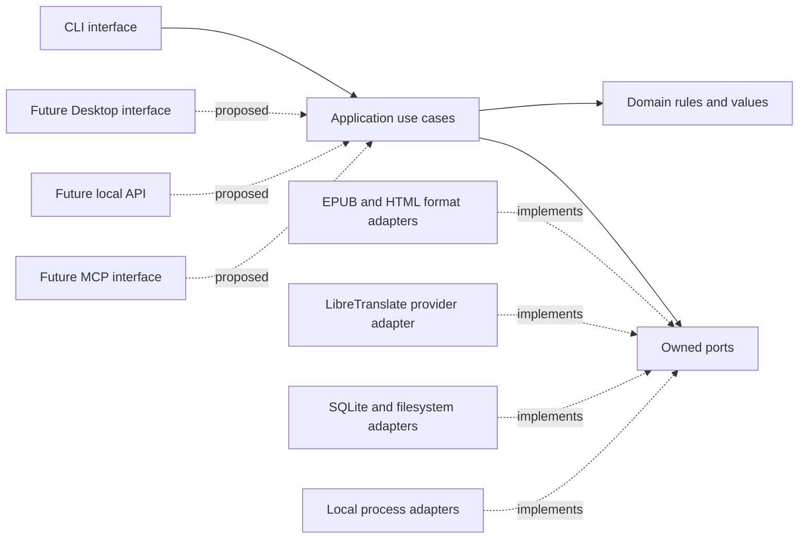
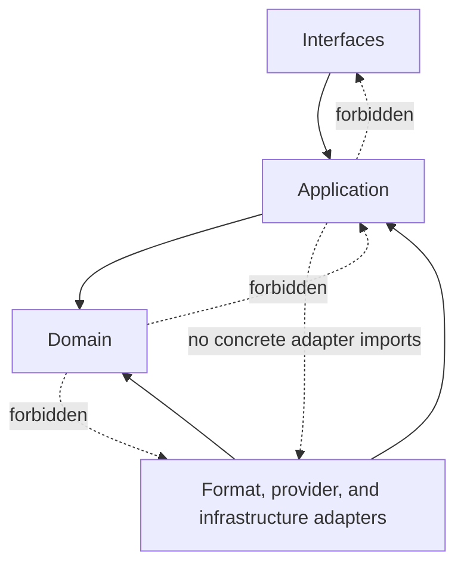

# Module and technical boundaries

The contracts of the [modular-monolith boundary decision](../decisions/modular-monolith-boundaries.md) (Accepted): architecture dimensions, dependency direction and technical boundaries. [Module ownership, flows and composition](module-ownership.md) and the [package-structure decision](../decisions/package-structure.md) complete them.

## Architecture dimensions

Layers describe dependency direction. Capability modules describe ownership of
behavior and data. They are separate dimensions: for example, Projects may
expose domain values, application use cases, and repository ports while a
filesystem adapter implements one of those ports. Neither dimension requires an
immediate directory per row.

### Layers and adapter roles

| Layer or role | Owns | Must not contain |
| --- | --- | --- |
| **Domain** | Stable value objects, invariants, identities, state transitions, and policy-neutral rules owned by capability modules | Framework types, persistence, HTTP, parsing, rendering, or use-case orchestration |
| **Application** | Commands, queries, use-case coordination, transaction boundaries, structured outcomes, and calls to inward-owned ports | Typer/Rich/Qt rendering, concrete SQL, HTTP payloads, EPUB DOM objects, or subprocesses |
| **Interface adapters** | CLI, future Desktop, local API, and MCP input/output adaptation | Core rules, direct database access, format reconstruction, or provider transport |
| **Outbound adapters** | Format parsing/rebuilding, provider protocols, repositories, filesystem, and process integration behind ports | Product policy or cross-use-case orchestration |
| **Composition roots** | Selection and construction of concrete adapters for one interface | Translation stages, format/provider branching, or business rules |

Infrastructure is the technical subset of outbound adapters: SQLite,
filesystem, HTTP, clock, processes, logging, and secret resolution. Format and
provider adapters have their own capability ownership even when they reuse
infrastructure primitives.

### Capability modules

| Capability module | Owns | Does not own |
| --- | --- | --- |
| **Projects** | Future project identity, manifest semantics, source identity, and project lifecycle | Durable job scheduling, UI state, or parser details |
| **Project profiles** | Closed project translation profiles, immutable revisions/snapshots, explicit legacy migration and stage-aware semantic projections; see [contract](../modules/projects-profiles.md) | Global preferences, glossary identity/content, provider requests or cache execution |
| **Jobs** | Future execution lifecycle, checkpoints, cancellation semantics, progress events, retry state, and artifact references | Widgets, terminal progress, provider payloads, or EPUB internals |
| **Content** | Minimal content documents, translation-unit identity, constraints, relationships, and opaque structural references produced by a format adapter | Concrete DOM nodes, archive paths as global identity, provider requests, or rendering |
| **Translation** | Language routing, the inward-owned provider port, format-neutral chunking and linguistic stage execution, translation requests/results, and stage policy | Structural HTML segmentation, EPUB representation, HTTP sessions, UI, or persistence engines |
| **Review** | Review units, revisions, decisions, conflicts, and import/export use-case semantics | CSV as the internal model, EPUB rewriting, or presentation widgets |
| **Quality** | Structured findings, deterministic checks, severities, and publication gates | Parser-specific nodes or terminal/GUI rendering |
| **Provenance** | Immutable records linking sources, operations, configurations, actors, and artifacts through digests and opaque references | Secrets, unrestricted access to other modules' stores, or mutation authority |
| **Formats** | Inspection, structural segmentation into Content units and opaque references, reconstruction, validation evidence, and fidelity claims for one format | Provider choice, cache policy, UI flow, or global job scheduling |
| **Providers** | Translation-engine adapter implementations, protocol mapping, availability, and provider-specific capabilities behind the port owned by **Translation** | Document formats, project state, cache storage, or interface presentation |
| **Assistants** | Future bounded terminology, context, quality, or review suggestions with evidence | Approval authority, silent mutation, policy decisions, or a generic AI gateway |
| **Knowledge** | Exact cache, translation memory, glossaries, and their distinct policies and repositories | Format reconstruction, provider transport, or interface prompts |
| **Artifacts** | Future artifact identity, digest, lineage reference, retention, and publication state | Format semantics or storage implementation details |
| **Policies** | Network, privacy, resource, retention, authorization, and output-safety decisions | Concrete confirmation dialogs, secret values, or transport clients |

Interfaces and infrastructure are adapter roles, not capability owners. Their
contracts belong to the capability that needs them. Provenance remains an
explicit owner reached through its public API; it is not permission for every
module to read every store.

## Dependency direction

The primary dependency rule is inward: interfaces and infrastructure depend on
stable application/domain contracts, not the reverse.

The diagram shows logical dependency, not runtime call direction. At runtime an
application service calls an adapter through a port; in source, the adapter
imports or implements the inward-owned contract.

### Allowed dependencies

- Interfaces may depend on application commands, queries, outcomes, and
  presentation-neutral DTOs.
- Application may depend on domain APIs and on ports owned by the use case or
  owning domain module.
- Domain modules may depend on small public APIs from another domain module only
  when the dependency is explicit, acyclic, and preserves ownership.
- Format, provider, persistence, filesystem, and process adapters may depend on
  the ports they implement and on vendor libraries required by that adapter.
- Composition roots may depend on concrete adapters solely to construct the
  object graph.
- Tests may cross boundaries to prove integration, but production code must not
  use test helpers as runtime dependencies.

### Forbidden dependencies

- Domain or application importing Typer, Rich, Qt, requests, ebooklib,
  Beautiful Soup, SQLite, MCP SDKs, widgets, HTTP responses, DOM nodes, or SQL
  rows.
- Formats importing providers, or providers importing formats. Application
  orchestration connects them through independent ports.
- Knowledge repositories importing CLI/Desktop presentation or format-specific
  nodes.
- Interfaces reading SQLite tables, manipulating EPUB internals, or invoking a
  provider client directly.
- CLI and Desktop importing each other or sharing framework-specific presenters.
- Infrastructure deciding product permissions, fallback, retention, or consent
  without an explicit policy input.
- A generic `utils`, `services`, or `common` module becoming an ownerless route
  around the boundaries.
- Dynamic plugin discovery, a universal document AST, or registries introduced
  only for hypothetical future adapters.

## Contract boundaries

### Commands, queries, and results

Application entry points accept presentation-neutral commands or queries and
return structured results. A result may contain identifiers, values, artifact
references, findings, warnings, and recovery guidance; it must not contain a
Rich table, Typer context, Qt object, HTTP response, Beautiful Soup node,
`sqlite3.Row`, or an open file handle.

Commands carry the requested action and its security-relevant context; they do
not carry a caller-controlled `authorized=true` assertion. When a use case can
overwrite, delete, open an external application, or use the network, **Policies**
issues or validates a scoped decision bound to the actor, action, source,
destination or endpoint, and data class. Decisions expire, are single-use where
replay is unsafe, and fail closed when missing, stale, or outside their scope. A
CLI confirmation is one way to request that decision. API and MCP callers cannot
self-assert it.

### Ports and adapters

A port is owned by the module that needs the capability. Ports describe
behavior, not vendors or storage engines. For example, a translation use case
may require a translation provider, exact-cache repository, checkpoint store,
format transformer, and artifact writer without depending on LibreTranslate,
SQLite, JSON, or EPUB classes.

Adapters translate at the edge:

- external exceptions become typed, sanitized application failures;
- concrete paths and payloads are validated before entering core decisions;
- secrets remain opaque references outside the adapter that resolves them;
- vendor capability gaps are explicit outcomes, never silent fallback;
- partial failures preserve completed work and ordered results where the
  existing behavior promises that property.

Document text, archive metadata, filenames, provider responses, and integration
messages are untrusted data. They cannot grant policy, filesystem, network,
process, secret, tool, or publication authority.

### Filesystem, archive, and artifact boundary

**Formats** validates archive member names, duplicate/ambiguous entries,
compression and expansion limits, and structural references before extraction
or rebuild. **Policies** authorizes resolved sources and destinations and rejects
an output that is the original or an alias of it. **Infrastructure** performs
contained, no-follow filesystem access with safe handles, defends against
symlink/hardlink and time-of-check/time-of-use substitution, and never writes a
derived artifact in place over its source.

An output is written to a temporary file on the destination filesystem, flushed
and validated, then published through an atomic replacement where the platform
supports it. A crash or validation failure must not expose a partial file as the
completed artifact. Platform-specific details remain adapter responsibilities,
but the immutability and containment outcomes are application invariants.

### Network boundary

**Policies** evaluates a normalized endpoint together with the data class and
requested operation before any network call. Offline, loopback, private-remote,
and public-remote modes remain explicit; a missing or incompatible decision
fails closed. Redirects are denied or re-authorized against their final endpoint,
and environment proxies are disabled unless the effective policy opts in.

Provider adapters enforce bounded connection/read timeouts, request and response
sizes, retries, concurrency, and cancellation. Consent and secret references are
bound to the authorized endpoint; a local-looking URL cannot silently redirect
content or credentials to another host. The exact policy defaults belong to
their dedicated implementation issues, not this record.

### Knowledge and process boundaries

Exact cache, translation memory, approved review data, and corpus are separate
stores and lifecycle policies. Cache content is never promoted automatically to
approved memory or a corpus. Any transfer requires an explicit use case,
purpose-scoped consent, provenance, retention, and revocation handling.

Process adapters receive structured argument vectors, use `shell=False`, select
an explicitly trusted executable, and minimize inherited environment variables
and file descriptors. Untrusted document text, filenames, or metadata never
select the executable, become shell syntax, or expand process authority.

### Error boundary

Domain errors describe invariant violations. Application errors add safe use-case
context, retryability, and recovery options. Interfaces map those errors to exit
codes, terminal messages, dialogs, or protocol responses. Adapters produce a
sanitized error envelope before data crosses their trust boundary. Raw exception
chains may exist transiently in process memory for control flow, but they are not
serialized, persisted, emitted through `exc_info`, or copied into logs,
diagnostics, history, or provenance. Vendor payloads, document text, credentials,
private paths, and secrets in URLs must not leak through results or observability.

### Progress and cancellation

Semantic progress and cooperative cancellation belong to application/job
contracts. Rich progress rendering belongs to the CLI, and future Qt signals
belong to the Desktop adapter. The reusable contract is defined in
[job events and cancellation](../modules/jobs.md). No use case has adopted
it yet, so current `KeyboardInterrupt` handling remains the compatibility baseline.
