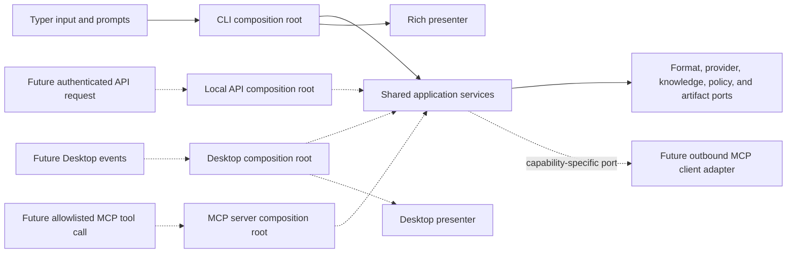

# Module ownership, flows and composition

Module ownership, flows, composition roots and the fitness functions of the [modular-monolith boundary decision](../decisions/modular-monolith-boundaries.md) (Accepted). Planned and historical items are marked as such where the text says so; current constraints still apply.

## Current module ownership and disposition

The table covers every production module present in `main` at the time of this
decision. A split disposition is intentional when a current file owns more than
one concern. It is a migration guide, not authorization to move code in this
issue.

| Current module | Current responsibility | Target owner and disposition |
| --- | --- | --- |
| `src/ayvu/__init__.py` | Package version metadata | Package public surface; keep minimal and independent of functional modules |
| `src/ayvu/interfaces/cli/app.py` | Typer, guided flow, confirmations, textual reports and output projection | **Interfaces/CLI**; invokes contracts and named functions from composition consolidated by #158 |
| `src/ayvu/composition/cli.py` | Deferred explicit construction of selected services/adapters | **Composition/CLI**; reuses per-capability composition, without registry or singleton |
| `src/ayvu/interfaces/cli/contracts.py` | Structural ports, compatibility results and shared errors | **Application**; without infrastructure or presentation framework |
| `src/ayvu/preferences/model.py` | V1 values and preference conversions | **Domain/Preferences**; `preferences/config_facade.py` preserves its compatibility reexports |
| `src/ayvu/interfaces/cli/progress.py` | Rich progress adaptation and snapshots | **Interfaces/CLI** keeps Rich rendering; semantic progress DTOs and cancellation later belong to **Application/Jobs** |
| `src/ayvu/kernel/values.py` (was `domain.py`, moved by REF-04) | Shared value objects and policies for languages, outputs, chapters, memory, and execution | Transitional domain collection; split only when a use case establishes ownership in **Domain**, **Translation**, **Jobs**, or **Policies** |
| `src/ayvu/preferences/config_facade.py` | Compatible facade over preference use cases and JSON repository | **Infrastructure**; construction selected in `composition.cli` and values in `preferences.model` |
| `src/ayvu/formats/epub/io.py` | EPUB inspection, selection, archive copying, translation coordination, review application, and report data | Archive and document composition remain in the **Formats/EPUB** adapter; cross-stage orchestration moves to **Application/Translation**; review semantics move to **Review** |
| `src/ayvu/v1/html_translate.py` | Visible-node selection, markup-safe reconstruction, chunk/cache/provider/glossary/TM coordination | Structural HTML segmentation, opaque references, and reconstruction remain an internal **Formats/EPUB** component that produces/consumes **Content** units; format-neutral linguistic execution moves incrementally to **Translation** |
| `src/ayvu/translation/chunking.py` | Ordered length-bounded text splitting | **Translation** pipeline policy; remains format- and provider-neutral |
| `src/ayvu/providers/libretranslate/client.py` | Translation protocol, routing, LibreTranslate HTTP, retries, rate limiting, and language discovery | Request/result and routing contracts move to **Translation**; LibreTranslate transport remains a **Providers/Infrastructure** adapter |
| `src/ayvu/network/policy.py` | Closed none/loopback vocabulary, pure destination classification and immutable per-request snapshot (#159) | **Policies/Domain**; without I/O or interface dependency; see [HTTP contract](network-policy.md) |
| `src/ayvu/network/http.py` | Single injectable resolution and Requests transport pinned to validated loopback sockaddrs, without environment or redirects | **Providers/Infrastructure**; consumes the Policies decision and adds neither provider nor interface entry point |
| `src/ayvu/translation/preflight.py` | Translation readiness checks and collaborator construction | Readiness coordination moves to **Application**; checks call format, knowledge, provider, and policy ports |
| `src/ayvu/v1/cache.py` | Runtime exact-cache identity, querying, mutation, and JSON interchange; shared schema in `knowledge/cache/legacy_schema.py` (REF-18 R3) | Exact-cache semantics belong to **Knowledge**; SQLite/JSON operations implement **Infrastructure** repository and interchange ports |
| `src/ayvu/knowledge/memory/fuzzy.py` | Fuzzy lookup over cached translations | Translation-memory policy and contracts belong to **Knowledge** and must remain distinct from exact-cache identity and storage |
| `src/ayvu/knowledge/memory/approved/model.py` | Governed TM identity, scope, value semantics and closed lifecycle | **Domain/Approved translation memory**; independent of operational cache and dataset consent |
| `src/ayvu/knowledge/memory/approved/service.py` | Governed TM commands, queries, use cases and repository port | **Application/Approved translation memory**; no SQLite or pipeline bridge |
| `src/ayvu/knowledge/memory/approved/store.py` | Dedicated SQLite values, immutable events, current approvals and migrations | **Infrastructure/Approved translation memory**; see [the contract](../modules/knowledge-memory.md) |
| `src/ayvu/knowledge/glossary/rules.py` | Glossary rules, matching, validation, and JSON persistence | Glossary semantics belong to **Knowledge**; JSON/filesystem persistence implements an **Infrastructure** port |
| `src/ayvu/recovery/checkpoint.py`, `src/ayvu/recovery/checkpoint_scan.py` | Shared checkpoint schema, scanning, persistence, and translation options | **Recovery** owns the shared checkpoint adapters (REF-18 R2); coordination stays in its application API and lifecycle semantics in **Jobs** |
| `src/ayvu/review/csv_export.py` | Review-segment representation and CSV writing | Review-unit semantics belong to **Review**; CSV serialization is an interchange **Infrastructure** adapter |
| `src/ayvu/review/csv_import.py` | CSV parsing, validation, and imported review rows | Review validation and decisions belong to **Review**; CSV parsing is an interchange **Infrastructure** adapter |
| `src/ayvu/review/exchange.py`, `exchange_model.py`, `exchange_parts.py`, `exchange_mapping.py`, `exchange_codec.py`, `exchange_files.py` | Deterministic v2 construction, contract validation, placeholders, reconstruction mapping, in-memory codec, and disk adapter | Review-package semantics belong to **Review**; EPUB structure remains in **Formats/EPUB**; only `exchange_files.py` accesses the filesystem; no application orchestration or publication |
| `src/ayvu/library/service.py`, `src/ayvu/library/adapters.py` | Library discovery and launching a reader process | Discovery/open coordination belongs to **Application**; filesystem scanning and process launch are separate **Infrastructure** adapters with explicit authorization |
| `src/ayvu/formats/epub/validation.py` | EPUB output validation and warnings using ebooklib/Beautiful Soup | Finding semantics belong to **Quality**; EPUB-specific inspection remains in the **Formats/EPUB** adapter |

## Current flows and target seams

These traces keep the accepted boundaries anchored in production behavior.

| Flow | Current path | Incremental target seam |
| --- | --- | --- |
| Translate EPUB / batch | `interfaces/cli/app.py` → `composition.cli` → `TranslateProject` / `TranslateBatch` and delivered ports | Services own execution, cancellation and publication; CLI projects events and results |
| Export review | `interfaces/cli/app.py` → composition → `ExportReviewPackage` with the exact translation result | Reconstruction and publication belong to Review and D106 adapters |
| Apply review | `interfaces/cli/app.py` → composition → `ValidateReviewPackage` / `ApplyReviewPackage` | Services validate revisions and publish; v1 is refused before source inspection |
| Inspect, clean, export, or import cache | `interfaces/cli/app.py` → composition → `knowledge.cache.admin` | Query/mutation and explicit authorization in services; SQLite/JSON in adapters |
| Resume interrupted translation | `interfaces/cli/app.py` → composition → `recovery.service` → same `TranslateProject` | Read-only inspection, explicit decisions and durable continuation; legacy checkpoint preserved |

No target seam changes the current result, output naming, ordering, cache/glossary
semantics, or source immutability unless a later issue explicitly revises the
public baseline.

## Composition roots

A composition root is the only place allowed to select concrete adapters and
construct the object graph. It may load configuration and effective policies,
create repositories and provider clients, and connect presenters to application
services. It must not execute translation stages or accumulate provider/format
conditionals that belong to owned modules.

### CLI composition root

The installed entry point `ayvu = ayvu.interfaces.cli.app:app` stays the same. `interfaces/cli/app.py` converts
arguments and confirmed choices to service inputs and presents their
results with Rich. `composition/cli.py` is the explicit boundary that selects
and constructs adapters per flow; capability composition modules
remain reusable. Import and `--help` neither open stores nor construct
providers. Cache-only acquires no provider, secret or transport; queries
open only required repositories. There is no service locator or singleton.

The [shared matrix](../modules/interfaces-cli.md) contains final owners,
the full helper/facade inventory, frozen base SHA and deferred construction
rules. #133 [executable rules](dependency-enforcement.md)
also check transitive dependencies and presentation reexports.

### Desktop composition root

The injectable Desktop root in `ayvu.composition.desktop` accepts
factories and environment overrides to assemble a graph, returning a sanitized
diagnostic on startup failure and closing acquired resources in reverse order.
Its package separates views, viewmodels, Qt adapter concerns, resources, and
platform concerns. It does not establish concrete adapters or a delivered
workflow; the desktop entry point remains a placeholder. A Desktop root may
build the same application services with Desktop presenters and event-loop
adapters. It must not import the CLI, reuse Rich objects, or create a parallel
EPUB/cache/provider core. This accepted decision itself introduced neither the
Desktop root nor a Qt dependency; see the [desktop evaluation](../decisions/adr-desktop-stack.md)
for the implementation's scope and the proposed toolkit decision.

### Future local API composition root

A future local API root maps authenticated, scope-limited protocol requests to
the same application commands and queries. Authentication, transport, and
response serialization remain interface concerns. The API cannot access
persistence tables, format internals, provider clients, or policy decisions
directly, and no endpoint is enabled by this decision.

### Future MCP boundaries

An inbound MCP server is an interface adapter with its own composition root. It
maps allowlisted tool calls to application use cases and cannot self-assert
filesystem, network, process, or mutation authority. An outbound MCP client is a
separate integration adapter behind a capability-specific port. Neither role is
an internal event bus, service locator, or route around application policy. This
decision implements neither role.

### Shared construction

Small construction helpers may be shared when they return interface-neutral
services and accept explicit configuration/policies. The interface roots remain
separate so importing or running the CLI never imports a future Desktop
framework, and vice versa.

## Incremental migration sequence

Migration follows a strangler-style sequence around real use cases:

1. Keep the current characterization baseline and use-case IDs as compatibility
   evidence.
2. Select one existing use case and define only the command/query, outcome, and
   ports required by that flow.
3. Wrap the current production implementation in adapters before considering a
   rewrite; preserve the established archive and markup behavior.
4. Move orchestration from `interfaces/cli/app.py` behind the application entry point while the
   CLI remains the active consumer.
5. Run focused characterization and full regression tests, then remove only the
   duplicated orchestration proven unreachable.
6. Repeat for the next use case, keeping temporary exceptions explicit and tied
   to a removal issue.
7. With human acceptance now recorded, implement fail-closed import enforcement
   separately in [#133](https://github.com/DevStarrk1137/ayvu/issues/133).
8. Add a future interface only after it can exercise a real shared application
   service without reaching through to concrete adapters.

This sequence forbids a big-bang package move. Physical package structure is an
output of proven seams, not a prerequisite for them.

## Fitness functions

Acceptance makes these checks eligible for enforcement through their own
implementation issue; this record does not implement them:

- every production module has an explicit owner and public API;
- domain/application imports remain free of presentation and concrete adapter
  libraries;
- formats and providers have no direct dependency in either direction;
- CLI and future Desktop composition roots depend on the same application
  contracts but not on each other;
- import analysis fails closed on syntax errors and unknown production packages;
- any transitional exception names the exact edge, owner, and removal issue;
- characterization tests continue proving source immutability, visible-text
  filtering, markup preservation, cache/glossary ordering, review, resume, and
  output validation;
- standard CLI installation and tests do not require optional Desktop
  dependencies.

Until #133 implements static enforcement, review of the real import graph and
the existing test suite provide evidence, not proof, of conformance.

## Public evidence

- [Accepted product threat model and privacy data flows](../decisions/product-threat-model.md)
- [Product scope and capability taxonomy](../../product-scope.md)
- [Translation workflow migration baseline](../../translation-workflow-migration-baseline.md)
- [Shared application use-case matrix](../modules/interfaces-cli.md)
- [`src/ayvu/interfaces/cli/app.py`](../../../src/ayvu/interfaces/cli/app.py)
- [`src/ayvu/formats/epub/io.py`](../../../src/ayvu/formats/epub/io.py)
- [`src/ayvu/v1/html_translate.py`](../../../src/ayvu/v1/html_translate.py)
- [`src/ayvu/v1/cache.py`](../../../src/ayvu/v1/cache.py)
- [`src/ayvu/recovery/checkpoint.py`](../../../src/ayvu/recovery/checkpoint.py)
- [`src/ayvu/providers/libretranslate/client.py`](../../../src/ayvu/providers/libretranslate/client.py)
- [`test_workflow_translation_resume.py`](../../../tests/interfaces/cli/test_workflow_translation_resume.py), [`test_workflow_route_review.py`](../../../tests/interfaces/cli/test_workflow_route_review.py), [`test_workflow_translation_reporting.py`](../../../tests/interfaces/cli/test_workflow_translation_reporting.py), [`test_workflow_batch_preview.py`](../../../tests/interfaces/cli/test_workflow_batch_preview.py)
