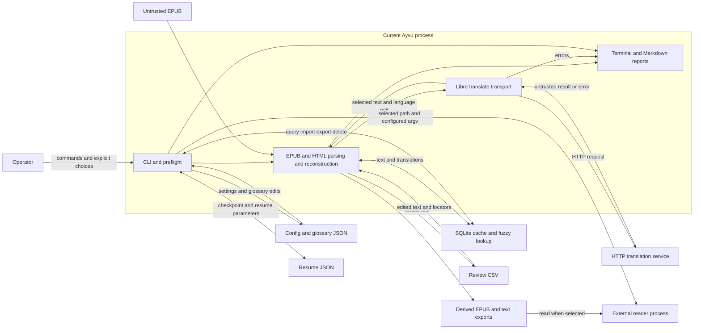

# Product security, privacy, and data flows

The model assessed by the [product threat assessment decision](../decisions/product-threat-model.md) (Accepted). Controls that the assessment proposed are still described as proposed.

## Assets, actors, and assumptions

| Class | Assets and sensitivity | Required treatment |
| --- | --- | --- |
| C1: content | Original and translated text, EPUB assets, review rows, glossary terms, missing-text exports, future context | Confidential by default; preserve source; minimize recipients and copies |
| C2: identifying metadata | Titles, authors, filenames, absolute paths, endpoints, language pairs, timestamps and stable hashes | Potentially identifying; neither metadata nor hashes imply public/anonymous data |
| C3: credentials and authority | Credentials embedded in a URL/environment, future secret references, approvals and capabilities | Values stay out of persisted contracts/diagnostics; references still require authorization |
| C4: state and provenance | Config, cache identity, checkpoints, future manifests, revisions, lineage, rights and revocation records | Validate as input; reject stale/ambiguous state; separate history from mutation authority |
| C5: execution assets | CPU, RAM, disk, process handles, dependency packages, model/plugin artifacts | Bound resource use and authority; verify origin and integrity |

Actors are the operator, another local account/process, an untrusted book or
review author, a malicious or compromised provider/reader, package maintainers,
and future API/MCP clients, tool/model suppliers and corpus recipients. An
operator can make an unsafe choice without intending an attack. A same-user
process can edit settings/checkpoints or replace files between checks and use.

Ayvu currently runs with the operator's OS privileges. The OS, Python runtime
and installed dependencies are part of the trusted computing base, not a
sandbox proven by Ayvu. OS compromise and malicious dependency execution can
defeat in-process checks. An independently running translator or reader has its
own filesystem/network authority, logging and retention. Loopback location does
not establish trust in that process or its downstream recipients.

## Current data flows and trust boundaries

Solid arrows below describe existing flows. Every node outside the Ayvu process
crosses an OS file, network, process, or human boundary; local storage is not
automatically trusted input.

| ID / owner | Entry and flow, grounded in current code | Existing check and remaining boundary |
| --- | --- | --- |
| B01 / Interfaces + Policies | CLI arguments/prompts and [config.py](../../../src/ayvu/preferences/config_facade.py) select paths, folders, profiles and reader command | Typer/path checks, folder-name validation and overwrite prompts exist; they are not a reusable scoped authorization decision |
| B02 / Formats + Content | [`formats/use_cases.py`](../../../src/ayvu/formats/use_cases.py) and [`formats/epub/adapter.py`](../../../src/ayvu/formats/epub/adapter.py) handle the active `inspect`/`extract` path; legacy `formats/epub/io.py` still contains `inspect_epub`, `extract_markdown` and `translate_epub`; [`formats/epub/archive.py`](../../../src/ayvu/formats/epub/archive.py) validates ZIP/container/OPF/spine lookup | The active adapter path applies archive size/member/name checks before parser reads and visible-content output uses full-plan validation with per-file staging. The legacy `formats.epub.io` facade is outside the migrated CLI path and retains its own behavior |
| B03 / Translation + Providers + Policies | [preflight.py](../../../src/ayvu/translation/preflight.py) resolves routes; [translator.py](../../../src/ayvu/providers/libretranslate/client.py) performs GET languages and POST text/languages; routed translation may make two hops | Timeout, retry/backoff, rate limiting and response-shape checks exist. #159 enforces HTTP loopback or no transport, validated socket addresses, disabled ambient proxies/credentials and redirects; response-size budgets remain separate |
| B04 / Knowledge | [cache.py](../../../src/ayvu/v1/cache.py) stores and imports/exports text; [translation_memory.py](../../../src/ayvu/knowledge/memory/fuzzy.py) retrieves fuzzy candidates; [glossary.py](../../../src/ayvu/knowledge/glossary/rules.py) loads/edits terms | SQL values are parameterized and import hashes validated; JSON import materializes the full payload without size or entry limits; hashes do not authenticate translations; cache has no provider identity or approved-TM lifecycle |
| B05 / Review + Formats | Bounded [review_import.py](../../../src/ayvu/review/csv_import.py) v1 inspection; [exchange_codec.py](../../../src/ayvu/review/exchange_codec.py) and [exchange_mapping.py](../../../src/ayvu/review/exchange_mapping.py) v2 codec/mapper; [review_application.py](../../../src/ayvu/review/application.py) and [local_packages.py](../../../src/ayvu/review/local_packages.py) and [local_operations.py](../../../src/ayvu/review/local_operations.py) local adapters, wired by [review.py](../../../src/ayvu/composition/builders/review.py) | V2 has byte/row/column/cell/content/metadata limits, reversible formula escaping, opaque revision-bound identities and protected-part validation. CLI export/apply use v2 and D106 publication; v1 apply stops with `legacy_reexport_required`. Review packages contain sensitive text and remain local files |
| B06 / Jobs + Infrastructure | [resume.py](../../../src/ayvu/v1/resume.py): `ResumeStateStore.save/load`; [cli.py](../../../src/ayvu/interfaces/cli/app.py): `_resume_translation` restores paths, URL and execution parameters | Version/field validation exists; write is direct and resume uses `overwrite=True`; no durable job identity, lease or source fingerprint authenticates that state |
| B07 / current writers: Formats + Infrastructure + Policies; future artifact state: Artifacts + Provenance (lineage) | `v1.epub._copy_epub_with_replacements`, the active [`formats/markdown/writer.py`](../../../src/ayvu/formats/markdown/writer.py), and CLI review/report/missing-text writers publish files | Visible-content Markdown validates canonical targets and stages each file before atomic publication; other file-writing paths retain their separately documented conflict and staging guarantees |
| B08 / Library + Infrastructure | [library_service.py](../../../src/ayvu/library/service.py) and [library_adapters.py](../../../src/ayvu/library/adapters.py) | Scan-local references, canonical containment and file identity are checked before an argv-based launch; the path may still change after that check. Configured executable, inherited environment and reader behavior remain outside containment |
| B09 / Interfaces + Policies | CLI terminal/progress/errors and `_render_markdown_report` consume names, warnings and operation failures | `inspect`/`extract` now show bounded format reason codes in developer mode and omit parser exception text. Other legacy provider/parser/report paths retain their existing presentation and need separate review |
| B10 / Maintainer + Infrastructure | [pyproject.toml](../../../pyproject.toml), [uv.lock](../../../uv.lock) and [CI](../../../.github/workflows/tests.yml) install/build dependencies | Lock checks, pinned Actions and package smoke are delivered; these do not certify package safety or implement a model/plugin/update installer |

HTML skips scripts/styles/code and other excluded nodes for translation; this
is not active-content removal. Existing book markup/assets are preserved and a
reader can interpret them. The v2 review mapper treats edited cells as plain
text and restores only issued protected parts after placeholder validation. The
legacy v1 CLI exporter remains separate and is not formula-neutralized. Treat
malicious imported or returned text as an integrity input, not as proof of code
execution in Ayvu.

## Storage, recipients, retention, and deletion

The following inventory describes current copies and egress. Current file
permissions follow ordinary OS/default creation behavior; there is no general
Ayvu encryption-at-rest or restricted-permission guarantee. No automatic corpus
upload, telemetry collector or model updater exists in the delivered code.

| Store / copy | Classes and location policy | Recipient, retention and deletion today |
| --- | --- | --- |
| Original and derived EPUBs | C1/C2; user-selected input/output, or configured book folders | Local operator and selected reader; outputs kept until removed; no automatic original deletion |
| Exact cache / fuzzy candidates | C1/C2/C4; `--cache`, default `.cache/traducoes.sqlite` relative to working directory | Original and translated strings stored in cleartext with pair/hash/time; no automatic TTL; cache-clean deletes selected rows, not all exported copies or forensic remnants |
| Cache interchange JSON | C1/C2/C4; explicit import/export paths | Export copies selected text pairs, potentially all rows; remains independently after cache deletion; imported data is untrusted |
| Glossary JSON | C1/C2; selected glossary/profile path or guided glossary directory | Terms/replacements retained until edited/removed; no corpus consent follows from glossary use |
| Config JSON | C2/C4; `ConfigStore` chooses XDG config or home fallback | Folders, reader command and named profiles persist until changed/removed; contains paths, not implemented secret-store references |
| Resume JSON | C2/C4 and possibly C3 in URL; configured processing folder | Absolute source/output/cache/glossary paths, endpoint and counters persist, including completed state; no lifecycle purge or cryptographic authority binding |
| Review CSV | C1/C2; explicit review output | Legacy v1 includes original/translated text and internal document paths; v2 contains text but uses opaque document/locator identities. Both are local sensitive copies that may be opened/shared by the operator; no automatic deletion or recipient revocation |
| Markdown, missing-text file, terminal | C1/C2, potentially reflected C3; configured/selected output and terminal | Reports include paths/errors; missing exports include untranslated content; scrollback, shell redirection, backups and copied files have independent retention |
| HTTP service | C1 for submitted chunks, C2 for language/endpoint/request metadata | Under loopback the local provider receives text on cache misses or an explicit fixed public test sample; none denies before payload. Ambient proxies/credentials and redirects are disabled. Server logging, downstream egress, training, backup and deletion are not controlled or attested by Ayvu |
| Process memory / external reader | C1–C5; Python heap, worker threads and reader process | May enter OS swap/core dumps or reader state; stopping the process is not proof of erasure |

Local deletion is not secure erasure and does not revoke an already exported or
sent copy. Hashing text is not anonymization: known passages can be correlated.
Future diagnostic bundles must preview an allowlisted manifest, omit content
and secret values by default, and require separate consent for any sample.

## Proposed network and authority policy

`none` and `loopback` are implemented by #159; the broader classes remain future
authorization, without CLI permission or an inferred trust decision:

| Mode | Proposed permitted authority | Current gap and implementation gate |
| --- | --- | --- |
| Strict offline | `none`: zero DNS/socket/HTTP from Ayvu's current HTTP adapter | #159 enforces all current callers, before session and payload; external readers are outside its guarantee. Future MCP/telemetry/download clients must reuse an accepted boundary |
| Loopback-only | `loopback`: only HTTP with validated canonical loopback hosts and socket addresses | #159 disables redirects and ambient proxies/credentials; an external server may itself send data elsewhere |
| Local network | Explicit LAN endpoint, operator and data-purpose decision | Denied today; formal consent/classification remains proposed |
| Private remote | Explicitly approved remote operator, endpoint, data classes, retention and authentication | Denied today; a private owner does not prove confidentiality; future remote authorization requires a separately reviewed policy |
| Public remote | Explicit provider/model, purpose, data categories, retention/training terms, volume/cost and revocable choice | Denied today; no inferred opt-in from book text, cache presence, tool descriptions, errors or an earlier unrelated approval |

An authorization must bind actor, action, project/source, destination, data
classes, purpose and expiry. Missing/stale/out-of-scope decisions deny the action.
Destination changes and redirects require denial or new authorization; network
errors must not silently select a different provider. Proposed private/public
remote operation is not authorized by #159, whose deliverable is strict-offline
and loopback policy. OS isolation and independent server/reader assurance remain
separate from application-level enforcement.

In the future secret boundary, persistent values are opaque `SecretRef`-style
references resolved only by the authorized adapter. They never contain a token
or imply permission to retrieve one. [#160](https://github.com/MichaelAlexandreDev/ayvu/issues/160)
owns the proposed store decision; it is not a delivered keyring. Error, repr,
event and diagnostic output must use approved fields rather than raw exceptions
or regex-only scrubbing.

## Threat register and implementation ownership

The threats T01–T12, with their scenarios, controls, owners and limits, are in the [threat register](threat-register.md).

## Proposed interfaces, isolation and corpus boundaries

| ID / owner | Intended input, output and authority boundary | Required gate and abuse evidence |
| --- | --- | --- |
| F01 / Interfaces + Application | Desktop submits user commands and renders structured outcomes through shared use cases | [#124](https://github.com/MichaelAlexandreDev/ayvu/issues/124) stays Proposed pending human choice; [#130](https://github.com/MichaelAlexandreDev/ayvu/issues/130)/[#131](https://github.com/MichaelAlexandreDev/ayvu/issues/131) cannot imply a delivered sandbox or safe active-content viewer |
| F02 / Interfaces + Policies | Local API and inbound MCP map authenticated, scoped requests to application commands/queries; local caller is not implicitly trusted | G01: reject arbitrary paths/SQL/shell and cross-project access; schema/size limits, per-action authorization, replay protection and negative tests before enabling listeners |
| F03 / Integration + Policies | Outbound MCP sends minimum purpose-scoped data to an allowlisted server/tool and receives untrusted structured data | G01: discovery grants no authority; endpoint/egress, credentials, time/size budgets, cancellation and malicious-result tests; no generic tool access to a project |
| F04 / AI + Translation + Policies | Optional assistance consumes approved context and returns suggestions/findings without approving edits or execution | #166/#165: role/permission matrix and hostile-response walkthrough; G02 for runtime adapter tests and human approval/publication boundary |
| F05 / Infrastructure + Policies | Workers, model loaders and third-party plugins receive minimal handles/argv and bounded protocol data | #167 (Accepted 2026-11-10) decides IPC, crash containment, CPU/RAM/time/output budgets and OS-specific limits; G02: no dynamic plugin loading until decision and implementation evidence; no pickle/eval/unchecked path or secret inheritance as IPC |
| F06 / Knowledge + Policies + Provenance | Approved memory and corpus are separate stores; authorized contribution exports only selected rights/purpose-compatible data and lineage | #161/#165/#138 provide upstream ownership; G04 gates dataset registry, license/recipient/retention evidence, export, withdrawal and revocation before any contribution/training |
| F07 / Projects + Artifacts + Provenance + Infrastructure + Policies | Backup/export/diagnostics/deletion cross project and recipient boundaries | G03: scoped paths, artifact lineage and copy inventory, preview/redaction, deletion conflicts and recovery tests; removal of managed state never authorizes source/output removal |
| F08 / Providers + Policies | Additional remote translation provider consumes selected content and opaque secret reference | #141/#103 contracts/capabilities and #159/#160 policy/store decisions precede runtime; [#100](https://github.com/MichaelAlexandreDev/ayvu/issues/100) remains separately gated; no silent vendor/model fallback |

The following gaps are tracked by this published model's issue **#129**, with
explicit capability owners and required follow-up acceptance. They are not
invented issue numbers or claims that a draft was published. Before starting a
downstream runtime, the maintainer must publish a dedicated implementation and
validation issue and link it here. Upstream decision work may proceed while
these runtime gates remain closed.

| Gate | Accountable owner / current issue linkage | Follow-up needed before exposure |
| --- | --- | --- |
| G01: API/MCP | Interfaces + Integration + Policies; #129 inventory, #159 network, #165 authority | Concrete inbound/outbound runtime, auth/project scopes, capability allowlists, schema/budget tests and hostile tool/client cases |
| G02: AI/plugins/models | AI + Infrastructure + Policies; #129 inventory, #166 roles, #167 isolation | Loader/runtime decision and implementation, origin/integrity/license validation, disabled-by-default discovery, process limits, hostile-output/crash tests and rollback |
| G03: diagnostic/backup/deletion lifecycle | Projects + Artifacts + Provenance + Infrastructure + Policies; #129 inventory, #134 project boundary, #138 provenance | Scoped backup/export/delete/bundle use cases, artifact lineage and copy inventory, secret/content redaction, interrupted deletion and recovery tests |
| G04: corpus lifecycle | Knowledge + Policies + Provenance; #129 inventory, #165 rights, #161 memory | Dataset contribution/registry/export/training scope, license/purpose validation, lineage and revocation propagation, recipient deletion limits and tests |
| G05: legacy exposure during migration | Formats + Application + maintainer; #129 residual risk, #144 plus #145/#147/#149 | Explicit prioritization of an earlier legacy safety patch if waiting for migration is unacceptable; ownership in the adapter backlog does not mean today's entrypoints are fixed |

The model leaves no authority to document instructions or model/tool responses:
they cannot choose files, expand context, change endpoint/provider, resolve
secrets, authorize a process, alter policy, approve consent or publish output.
Schema-valid output is still untrusted. Enforcing this rule belongs to ordinary
application/policy code and OS controls, with failure producing no unauthorized
side effect. Human choices must be explicit, scoped and informed by the real
recipient/data flow; a model-generated `approved=true` field is never evidence.

## STRIDE and LINDDUN coverage walkthrough

These are source/design walkthrough results, not executed exploit tests.
Categories follow [Microsoft's STRIDE guidance](https://learn.microsoft.com/en-us/azure/security/develop/threat-modeling-tool-threats)
and the [LINDDUN threat types](https://linddun.org/threat-types/). The scenarios
below are Ayvu-specific analysis; evidence and proposed test ownership are in
the threat register.

| Lens | Synthetic abuse case reviewed | Result / trace |
| --- | --- | --- |
| STRIDE: spoofing | A service binds the configured localhost port; a future local client claims another project | Loopback alone is not identity; T03/T09, G01 |
| STRIDE: tampering | Replace output with a source hardlink; change a checkpoint URL or CSV source ID | Current checks are incomplete; T01/T06/T07 |
| STRIDE: repudiation | A resumed job/export lacks a stable record of authorized actor/revision | Current checkpoint is not an audit log; T07/T11, #138 |
| STRIDE: information disclosure | Provider returns submitted text in HTTP error; operator shares Markdown report | Body can propagate to saved diagnostics; T03/T04/T11 |
| STRIDE: denial of service | Tiny compressed archive expands greatly; provider streams excessive content; import has too many rows | Current budgets insufficient; T02/T06/T12 |
| STRIDE: elevation of privilege | Book/tool asks to execute a reader command, resolve a secret or grant itself network access | No content authority in proposed design; T08/T09/T10, G01/G02 |
| LINDDUN: linking | Stable text hash and language/timestamp pairs link copies across caches/exports | Hashes are not anonymous identifiers; T05/T11 |
| LINDDUN: identifying | Author/title, source path or rare passage reveals person/work | Class C2 and content need minimization; T04/T11 |
| LINDDUN: non-repudiation | Durable provenance could tie an operator to sensitive reading/editing history; [the current records](../decisions/provenance.md) hold actor kinds and no person | Audit accountability and privacy conflict; minimize/limit access and retention; T07/T11 |
| LINDDUN: detecting | Cache summary, checkpoint names or diagnostics reveal that a book/project exists | Metadata exposure remains sensitive; T04/T11, G03 |
| LINDDUN: data disclosure | Export, backup or provider retains cleartext after local cache deletion | Copy and recipient lifecycle is independent; T03/T11 |
| LINDDUN: unawareness | Operator assumes localhost never forwards data or cache use permits training | Explicit recipient/purpose disclosure required; T03/T05/T11 |
| LINDDUN: non-compliance | Future corpus includes content outside its granted purpose, license or retention | Deny unknown rights, document uncertainty and revocation limits; T11, #165/G04 |

Prompt-injection analysis is informed by the
[OWASP prompt-injection guidance](https://genai.owasp.org/llmrisk/llm01-prompt-injection/):
separating trusted instructions from untrusted content alone does not establish
an authorization boundary. The negative result required here is no additional
file, network, tool, secret or publication action when hostile content requests
one. This requirement covers retrieved context and returned tool/model data as
well as books.
